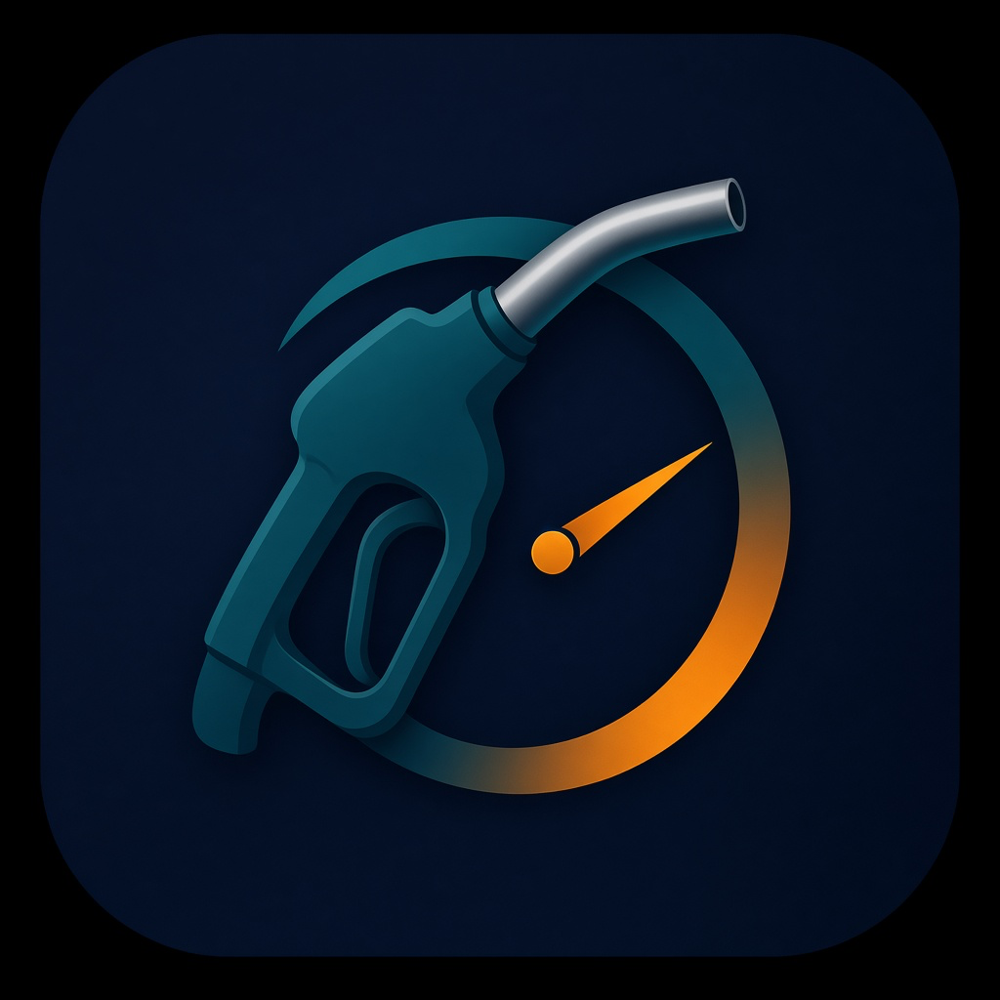
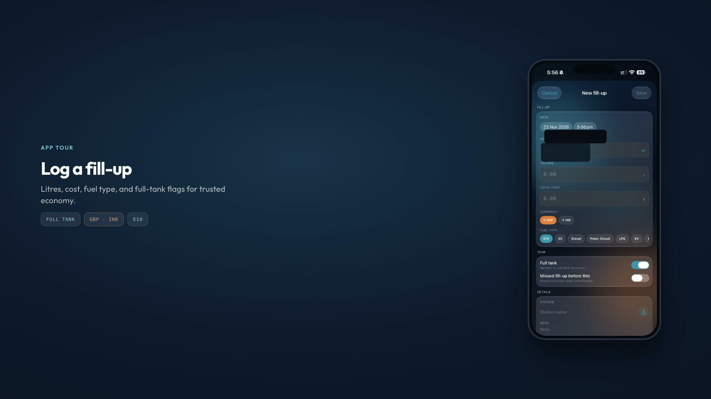
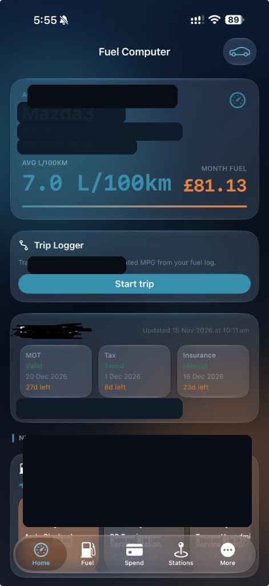
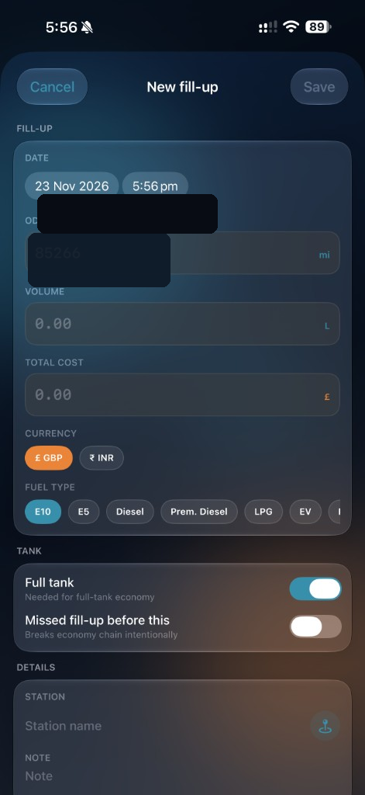
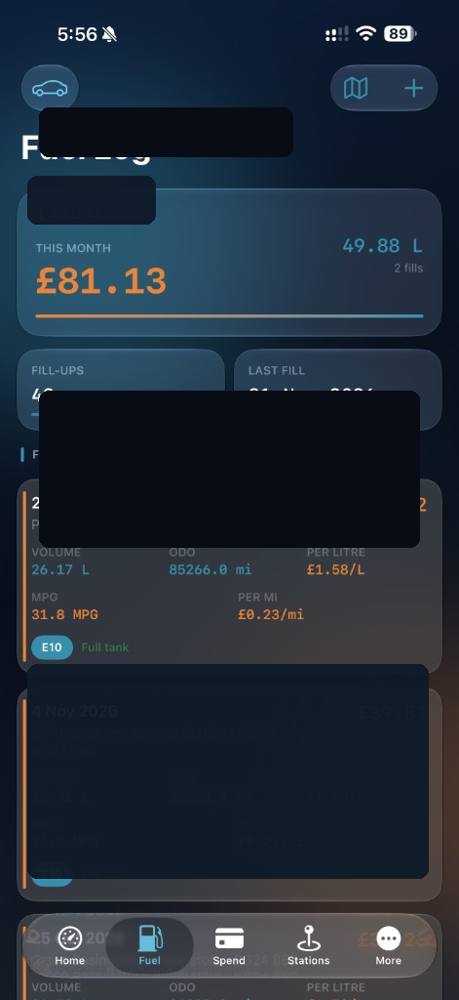
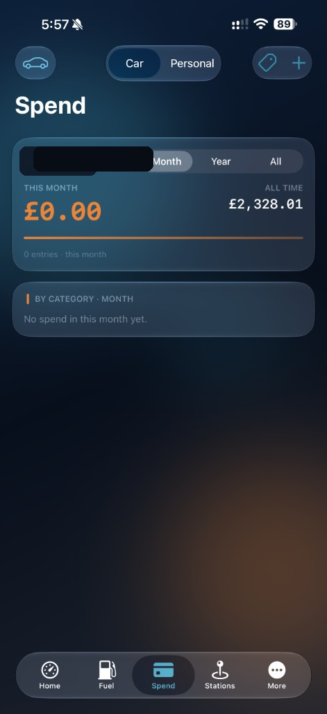
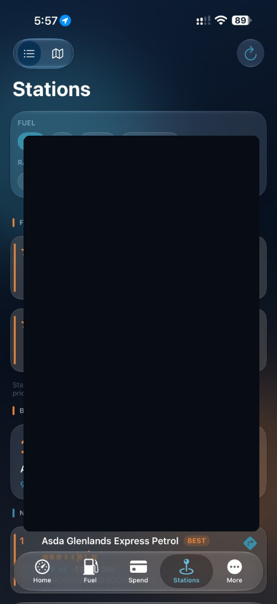
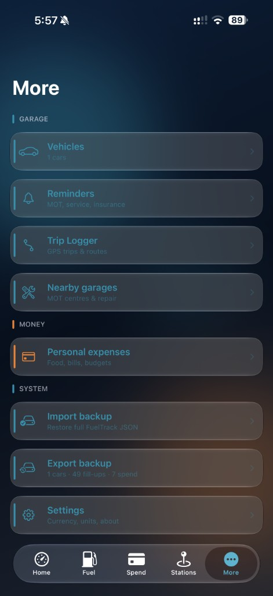

# FuelTrack

<p align="center">
  
</p>

**Privacy-first multi-vehicle fuel tracker for iPhone** — SwiftUI + SwiftData, UK-oriented MOT/tax reminders, nearby stations & garages, trip logger, and on-device backups. No account. No cloud in v1.

[](#)
[](#)
[](#contributing)

## Demo

22s product tour (phone UI walkthrough):

https://github.com/ajaybali9/FuelTrack/blob/main/docs/demo/fueltrack-explainer.mp4

[](docs/demo/fueltrack-explainer.mp4)

### Screens (identifiers redacted for privacy)

| Home | Fill-up | Fuel log |
|:---:|:---:|:---:|
|  |  |  |

| Spend | Stations | More |
|:---:|:---:|:---:|
|  |  |  |

Source composition for the tour: [`marketing/fueltrack-explainer/compositions/phone-tour.html`](marketing/fueltrack-explainer/compositions/phone-tour.html).

## Features

- Multiple vehicles with active-vehicle selection
- Fill-up log (litres, full/partial tank, missed fill-up flag)
- Full-tank economy: L/100km, UK MPG, cost/distance — on Dashboard and Fuel Log cards
- GBP and INR currencies; miles or kilometres per vehicle
- Trip logger (GPS distance, speed, estimated economy)
- Car + personal spend tracking
- Nearby UK fuel prices and nearby MOT / repair garages
- MOT, tax, insurance reminders (DVLA Vehicle Enquiry — optional API key in Settings)
- Native FuelTrack JSON backup export / import
- On-device SwiftData storage

## Project layout

```
Sources/FuelTrack/
  Models/       Vehicle, FillUp, Trip, enums
  Services/     FuelStats, DVLA, stations, garages, backup
  Views/        Dashboard, Fill-ups, Spend, Stations, More, …
docs/demo/      Public demo video + redacted screenshots
marketing/      HyperFrames explainer source (compositions)
```

## Requirements

1. **Xcode** (full app, not only Command Line Tools) — iOS SDK  
2. **[xtool](https://xtool.sh)** — `brew install xtool-org/tap/xtool`  
3. A connected iPhone with **Developer Mode** enabled (for device installs)

## Setup

```bash
# Point at Xcode
sudo xcode-select -s /Applications/Xcode.app/Contents/Developer

# Authenticate xtool (Apple ID)
xtool setup   # or: xtool auth login

# Build, sign, install, launch (updates in place — does not wipe data)
cd /path/to/FuelTrack
xtool devices
xtool dev
```

Bundle ID: `com.ajaybali.FuelTrack` (see `xtool.yml`).

> **DVLA:** add your own Vehicle Enquiry API key in **More → Settings**. Keys stay on-device (`AppStorage`) and are never committed to this repo.

## Verify without a device

```bash
swift Scripts/fuelstats-smoke.swift
swift Scripts/backup-roundtrip-smoke.swift
swift Scripts/tripstats-smoke.swift
```

## Contributing

This repo is **public and read-oriented**: browse and fork freely. Direct pushes to `main` are restricted — please **open a pull request**.

1. Fork the repo  
2. Create a branch for your change  
3. Run the smoke scripts above  
4. Open a PR against `main`

## Privacy note for demos

Demo screenshots and the sample video are **redacted** (registration plates, home map pin, local station favourites / spend). They illustrate UI only — not live personal data.
